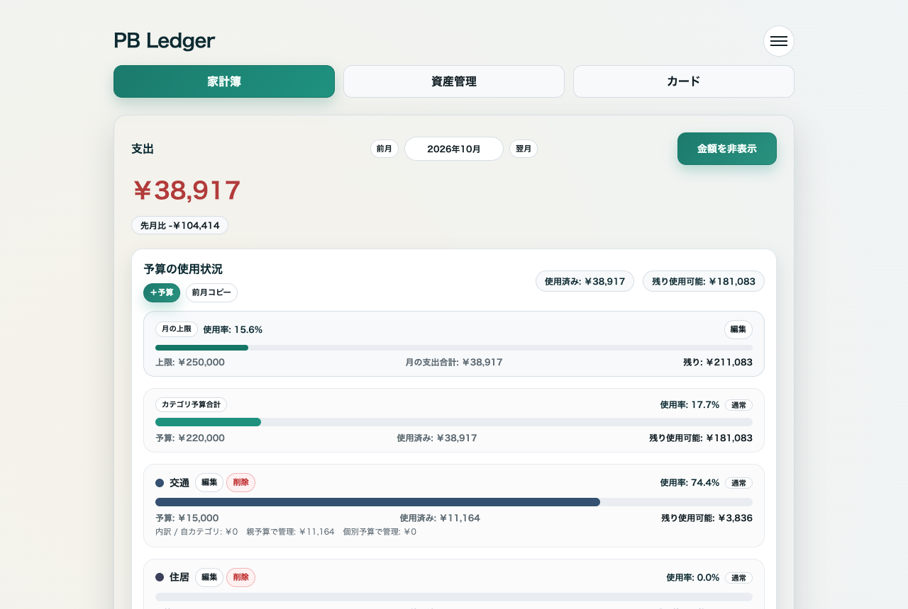
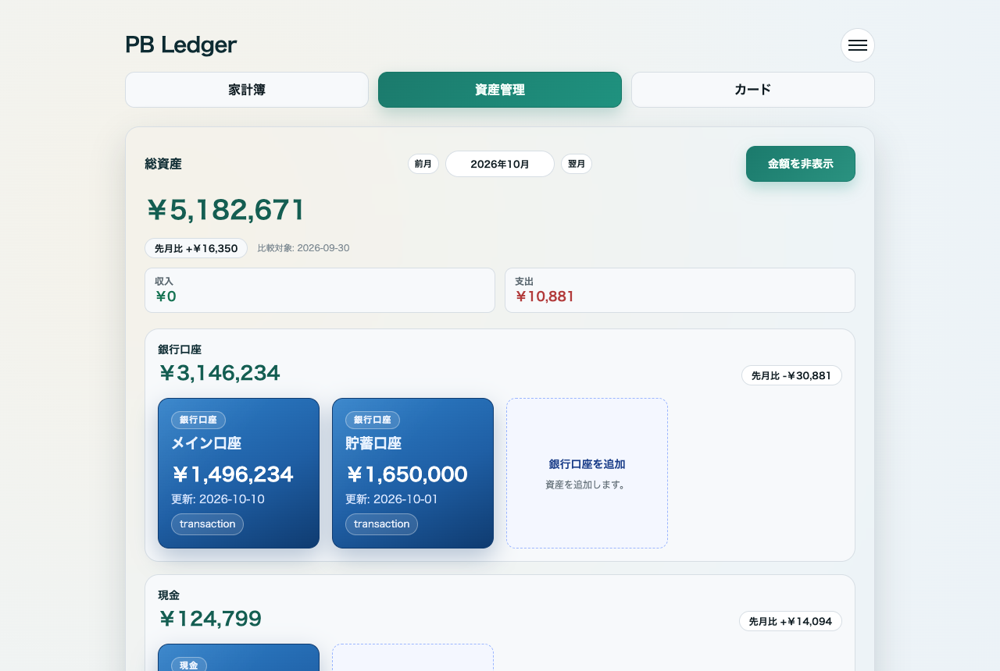
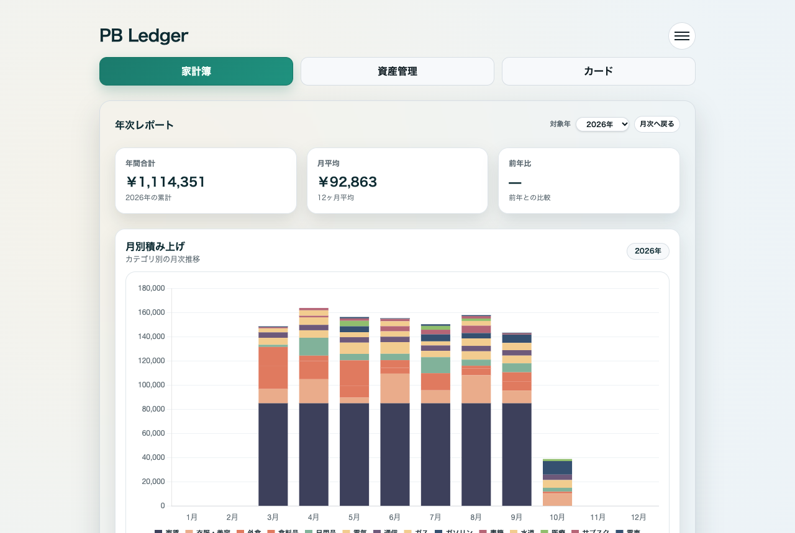
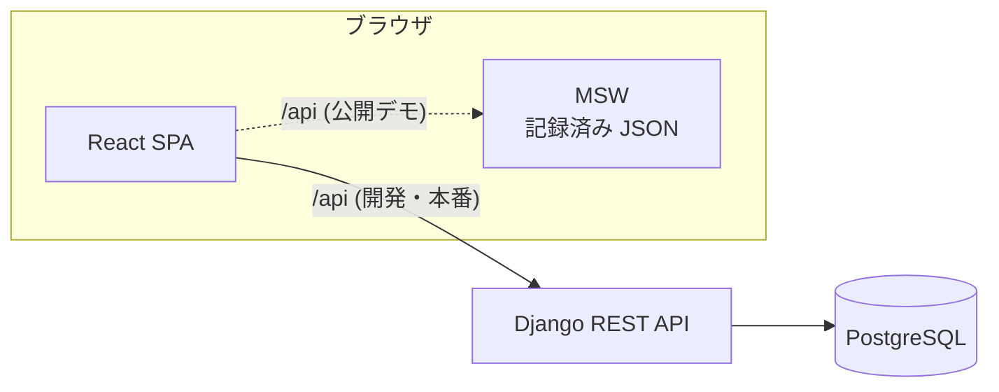

# PB Ledger

[](https://github.com/beginner-python/pb-ledger/actions/workflows/ci.yml?query=branch%3Amain)

個人向けの家計アプリです。月ごとの予算と支出、銀行口座や現金の残高、クレジットカードの利用額を一つの画面で記録します。自分の家計で約 10 か月使ってきたアプリから、公開用に切り出したものです。

- デモ: https://beginner-python.github.io/pb-ledger/
- デモは架空のデータで動く閲覧専用の環境です。バックエンドは動いておらず、入力しても保存されません。
- Django 6 / Django REST Framework / PostgreSQL 16 / React 19 / TypeScript / Vite 7 / Tailwind CSS 4



## 機能

| 画面 | できること |
|---|---|
| 家計簿 | カテゴリごとに予算を決め、支出を記録する。月の上限との差、カテゴリ別の内訳、日別の推移を出す。年次レポートは月別の積み上げと年間合計 |
| 資産管理 | 銀行口座、現金、投資信託などの残高を日付ごとに残す。銀行明細は CSV から取り込み、入出金を振替として他口座と紐付ける |
| カード | カード明細を CSV で取り込み、月ごとの利用額を出す。明細は家計簿の支出に紐付ける |




## 構成



公開デモはフロントだけを GitHub Pages に置いています。手順は、架空データを投入する `seed_demo`、フロントが使う GET 応答を JSON に記録する `record_demo_fixtures`、その JSON を Mock Service Worker が返す demo ビルド、の三つです。サーバーを持たないので運用費はかからず、初回アクセスの待ち時間もありません。

| 層 | 主な技術 |
|---|---|
| バックエンド | Django 6.1、Django REST Framework 3.18、SimpleJWT、psycopg 3、uv、ruff |
| フロントエンド | React 19、TypeScript 5.9、Vite 7、Tailwind CSS 4、TanStack Query 5、Zustand、Chart.js 4、MSW 3 |
| 実行環境 | Docker Compose（開発）、GitHub Pages（デモ） |

## 設計で判断したこと

**認証はアクセストークンをメモリ、リフレッシュトークンを HttpOnly Cookie に置く。** アクセストークンは有効期限 10 分で JSON として返し、フロントはメモリにだけ持ちます。リフレッシュトークンは `/api/auth/` に限定した HttpOnly Cookie で 30 日保持し、使うたびに再発行して古いものを失効させます。これで XSS からリフレッシュトークンを守り、リフレッシュとログアウトの API は Origin ヘッダが設定値と完全一致する場合だけ受け付けることで CSRF を防ぎます。

**CSV の再取込は件数で重複を判定する。** 金融機関の CSV は、同じ利用でも摘要の表記（承認番号や接頭辞）が後から変わることがあります。まず全項目が一致する既存行を 1 行ずつ消費し、残った行は日付・金額・残高が同じ既存行の件数を上限に読み飛ばすので、表記が変わっても二重登録されず、同じ店で同額を 2 回使った日は 2 件として残ります。

**残高の求め方を口座の種別で分ける。** 銀行口座は明細の残高列とスナップショットの新しい方を採用します。現金は明細が無いので、直近のスナップショットにその後の振替・支出・入出金を足し引きして動的に計算します。カードは残高ではなく当月の利用額の合計を出します。

**カテゴリは親子の 2 段に固定し、親予算 ≥ 子予算の合計を保つ。** 階層を深くすると集計の読み方が人によって変わるため 2 段で止めています。制約はモデルの `clean()` と API の両方で検証し、管理画面やシェルから保存した場合も破れないようにしています。

**公開デモはバックエンドを持たない。** 無料枠のサーバーは数分でスリープして初回アクセスに 1 分近く待たせるか、データベースが一定期間で消えます。閲覧できれば十分な用途なので、実バックエンドの応答を記録して静的に配信する形にしました。

## ローカルで動かす

Docker と Docker Compose が必要です。

```sh
docker compose up -d
docker compose exec backend python manage.py migrate
docker compose exec backend python manage.py seed_demo
```

http://localhost:5173 を開き、`demo@example.com` / `demo-password` でログインします。初回はコンテナ内で依存関係をインストールするため、画面が開くまで数分かかります。`seed_demo` はデモと同じ架空データを投入します。空の状態から始める場合は代わりに `docker compose exec -e DJANGO_SUPERUSER_EMAIL=... -e DJANGO_SUPERUSER_PASSWORD=... backend python manage.py create_default_superuser` で利用者を作ります。

テストと静的解析（フロントは Node 24）:

```sh
docker compose exec backend python manage.py test
docker compose exec backend ruff check .
cd frontend && npm ci && npm run lint && npm test && npm run build
```

フロントのテストは Vitest と Testing Library で、公開デモと同じ記録済み応答を MSW から流して画面の集計まで確認します。

公開デモ用の JSON を作り直す場合は、上の手順で投入したデータに対してホスト側から記録コマンドを実行し（[uv](https://docs.astral.sh/uv/) が必要）、demo モードでビルドします。

```sh
cd backend && DJANGO_SETTINGS_MODULE=pb_ledger.settings.local DB_HOST=127.0.0.1 uv run --extra dev manage.py record_demo_fixtures
cd ../frontend && npm run build:demo
```

## 既知の制限

- デモは閲覧専用です。追加・編集・削除・CSV 取込はすべて拒否されます。
- カードの締め日・引落日は保存されますが、まだ集計に使っていません。
- サインアップ画面はありません。利用者は管理コマンドで作成します。

## ライセンス

MIT
